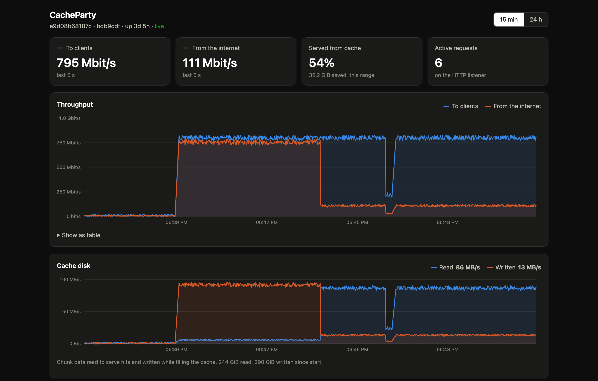

#  CacheParty

A faster drop-in replacement for
[lancache](https://github.com/lancachenet/monolithic): one binary that caches
game downloads for your whole LAN.

Like lancachenet/monolithic, it sits behind
[lancache-dns](https://github.com/lancachenet/lancache-dns). Clients resolve CDN
names to this machine; it caches plain-HTTP downloads from Steam, Battle.net,
Epic, Riot, Xbox/WSUS, PlayStation and anything else in
[cache-domains](https://github.com/uklans/cache-domains).

Drop-in means the same environment variables and the same `access.log` format. Non-goals: caching HTTPS (`:443` is a blind SNI
passthrough), reading nginx's on-disk cache format.

[](docs/monitoring.md#dashboard)

## Advantages over stock lancache

### Faster downloads

- **Streaming request coalescing.** Many clients asking for the same uncached
  chunk cause one upstream fetch, and every client receives bytes as they
  arrive. nginx's `proxy_cache_lock` makes waiters poll for about 500 ms and
  wait for the whole slice. In [benchmarks](docs/benchmarks.md) with 50
  clients, cold time to first byte drops from about 500 ms to 50–135 ms, and
  cold throughput for Steam-style many-small-file downloads is about 1.6x.
- **Adaptive read-ahead.** After a miss, CacheParty fetches the chunks a client
  will need next, growing the window on slow origins while sharing it fairly
  between downloads.
- **No internal proxy hop.** Redirects are followed inside the upstream client
  instead of through a second server on `localhost:3128`.
- **Fast domain lookup.** A hash map plus a reversed-label suffix tree instead of
  thousands of regexes per request.

### Easier to run

- **Internet download speed limit.** `UPSTREAM_RATE_LIMIT` (e.g. `500m`)
  caps how much internet bandwidth the cache uses, so a big download doesn't
  slow down the rest of the network. Cache hits still run at full LAN speed.
- **Fast restarts.** A persistent chunk index (bbolt) means startup does not
  walk millions of files.
- **Built-in dashboard.** Live throughput, cache hit share, and per-service,
  per-game, per-client and per-CDN-host traffic, at `http://<host>:8080/`,
  plus Prometheus `/metrics`. See [Dashboard, metrics and logs](docs/monitoring.md).
- **Live settings.** Cache size, free-space floor, max age, read-ahead,
  upstream rate limit and bypass domains can be changed from the dashboard
  without a restart.
- **Cache repair and purge.** Bad chunks are repaired on the fly when
  requested, `cacheparty verify` checks the whole cache without reading chunk
  contents, and `cacheparty purge` (or the dashboard) removes one game. See
  [Cache repair](docs/cache-repair.md).
- **Bypass domains.** `BYPASS_DOMAINS` sends chosen hosts straight through
  uncached.

### Safer caching

- **Never serves wrong bytes.** If an object changes upstream, all of its
  chunks are dropped; truncated upstream responses abort the client rather
  than looking complete.
- **Stricter domain matching.** Hosts are matched on whole DNS labels, so
  `evilsteamcontent.com` is not cached as Steam.

See [Compatibility](docs/compatibility.md) for every behavior difference from
nginx lancache and the known limitations.

## Quick start

```sh
docker run -d --name cacheparty --restart unless-stopped \
  -p 80:80 -p 443:443 -p 8080:8080 \
  -v /srv/cacheparty:/data \
  -v /mnt/cache:/data/cache \
  ghcr.io/antiremy/cacheparty
```

`/data` holds logs, settings, dashboard stats and the cache-domains checkout;
`/data/cache` holds the cached chunks and their index, so mount it from the big
disk. Swap in your own host paths. CacheParty can't read nginx's cache format,
so give it an empty directory rather than an existing monolithic cache.

The image is published to GHCR and Docker Hub for amd64 and arm64: `latest`
tracks `main`, and releases are tagged by version (`1.2.3`, `1.2`, `1`).
Each [GitHub release](https://github.com/antiremy/CacheParty/releases) also
has static `linux/amd64` and `linux/arm64` binaries. To build the image
yourself, run `docker build -t cacheparty .`.

Then point `lancache-dns` at the host's IP and open `http://<host>:8080/` for
the dashboard. The image is built on `distroless/static`, runs as root so it
can bind `:80`/`:443`, and has a `HEALTHCHECK` that calls
`/cacheparty healthcheck` (a request to `/lancache-heartbeat`).

Set `DASHBOARD_PASSWORD` to allow changing settings and repairing the cache
from the dashboard; without it the dashboard is read-only. All variables are
listed in [Configuration](docs/configuration.md).

Run locally without root:

```sh
NOFETCH=true DOMAINS_DIR=./testdata/domains LOG_DIR=/tmp/gc-logs \
HTTP_ADDR=127.0.0.1:8081 SNI_ADDR=127.0.0.1:8443 METRICS_ADDR=127.0.0.1:8080 \
  go run ./cmd/cacheparty
curl -H 'Host: example.com' http://127.0.0.1:8081/
curl http://127.0.0.1:8080/metrics
open http://127.0.0.1:8080/         # dashboard
```

## Documentation

- [Configuration](docs/configuration.md): environment variables, live
  settings, memory limits, log rotation.
- [Dashboard, metrics and logs](docs/monitoring.md): what the dashboard shows,
  `/metrics`, and the log formats.
- [Cache repair](docs/cache-repair.md): `cacheparty verify` and `cacheparty purge`.
- [How it works](docs/how-it-works.md): listeners, cache keys and chunking,
  coalescing, read-ahead, bypass rules, upstream fetching, storage and eviction.
- [Compatibility](docs/compatibility.md): differences from nginx lancache and
  known limitations.
- [Benchmarks](docs/benchmarks.md): methodology and results against
  monolithic.
- [Development](docs/development.md): tests, linting and package layout.

## License

MIT. See [LICENSE](LICENSE).
