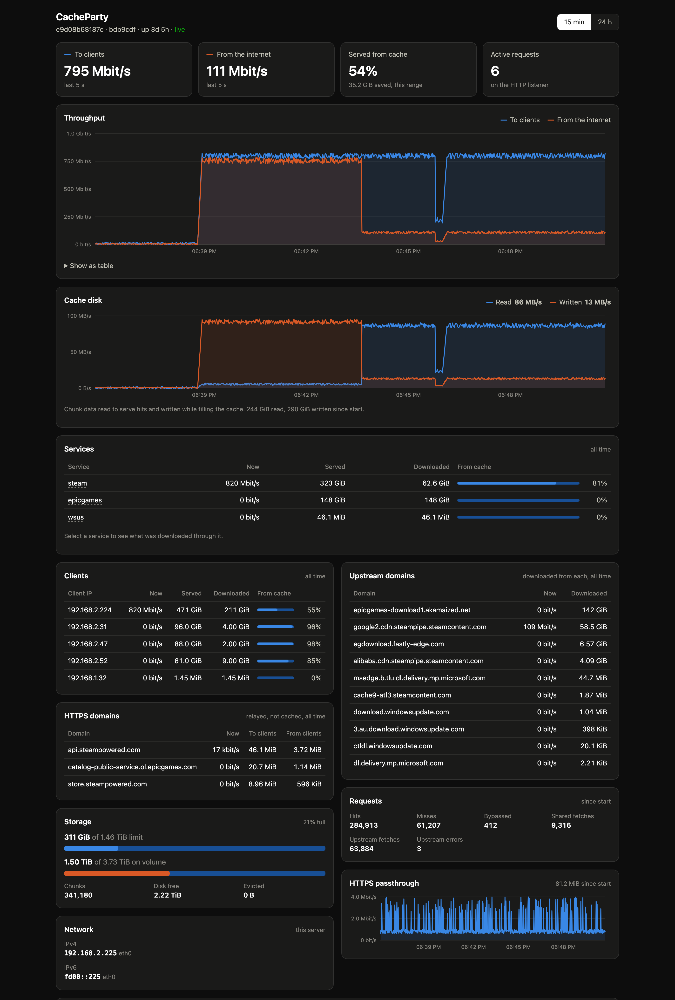

# Dashboard, metrics and logs

All three monitoring endpoints are served on `METRICS_ADDR` (`:8080` by
default): the dashboard at `/`, Prometheus `/metrics` and `/healthz`.

## Dashboard

`http://<cache>:8080/` shows live throughput to clients and from the
internet (15 minutes at 1 s resolution, or 24 hours at 1 min), the share
served from cache, a per-service table (cache identifier, so `steam`,
`epicgames` and so on), cache usage against its limit, request counts and
`:443` passthrough traffic.

Bytes are counted as they move rather than when a request ends, so a long
download shows as steady throughput, not a spike at the end. "From the
internet" includes read-ahead, so for a moment it can exceed what clients
have received. Up to 64 services are listed separately; the rest are summed
as `other` (an unmatched Host is its own identifier).

### Per-game breakdown

Clicking a service lists what was downloaded through it, with the same
columns plus when each last moved bytes. Where the URL names the game it is
picked out: Steam depot IDs (linked to SteamDB, which names the game),
Blizzard product codes (`wow`, `fenris`, …) and Epic build names. Other
services are broken down by CDN host, which often separates games too
(`lol.dyn.riotcdn.net`, `valorant.dyn.riotcdn.net`). Up to 500 are listed
per service. With `DASHBOARD_PASSWORD` set, each can be purged from the cache
from there (see [Cache repair](cache-repair.md#purging-a-game)).

### Clients and upstream domains

Two more lists sit under the throughput chart:

- **Clients**: the bytes sent to each client IP and downloaded from the
  internet on its behalf (so what came from cache). Up to 1000 are listed.
- **Upstream domains**: the bytes downloaded from each CDN host (the request's
  Host, as in the per-game breakdown). Up to 500 are listed.

The rest are summed as "Others".

### HTTPS domains

With the `:443` passthrough on (`SNI_ADDR`), the **HTTPS domains** card lists
each server name clients connected to over HTTPS, with the bytes relayed to
and from clients. None of it is cached, so it shows which launchers or games
are downloading over HTTPS and how much traffic goes past the cache. Names that
could not be reached are left out; up to 500 are listed and the rest summed as
"Others". The `stream-access.log` has the same traffic per connection.

### Cache disk and network

The **Cache disk** chart shows the rate chunk data is read from disk to serve
hits and written while filling the cache, in bytes per second. These are
CacheParty's own reads and writes; a hit served from the OS page cache counts as
a read even though the disk itself was idle.

The **Network** card lists the server's IPv4 and IPv6 addresses, by interface
(loopback and link-local addresses are left out), so you know what to point
`lancache-dns` at. In a container these are the container's addresses unless
it uses host networking.

### Settings

Some settings can be changed from the dashboard while running; see
[Live settings](configuration.md#live-settings).

### What survives a restart

The throughput charts are kept in memory and start empty on each restart. The
byte totals (per service, game, client, upstream host and HTTPS domain, and when each game
last moved) are saved to `STATS_FILE` every minute and at shutdown, and carry
on after a restart; delete the file to start them from zero. A crash loses up
to a minute of them.

The per-game, client and domain figures are not exported to `/metrics`, to
keep its label count small.

### Security

Viewing is open to anyone who can reach `:8080`, like `/metrics`. Changing
settings, and checking or purging the cache, needs `DASHBOARD_PASSWORD`, sent
as a bearer token; without it the settings are read-only, which is the
default because guests at a LAN party share the network. Wrong passwords are
answered one a second. The page is served from the binary (no CDN) with a
strict Content-Security-Policy, and cross-origin writes are refused.

## Metrics

`/metrics` is a small in-tree text-format renderer (counters, one-label counters
and scrape-time gauges) instead of `client_golang`, to keep the dependency list
short. Go runtime and process metrics are not exported. `/healthz` returns
`200 ok` while the process is serving.

| Metric                                               | Meaning                                                                      |
| ---------------------------------------------------- | ---------------------------------------------------------------------------- |
| `cacheparty_http_requests_total{cache_status}`       | HTTP requests handled on `:80`, by cache status                              |
| `cacheparty_http_response_bytes_total{cache_status}` | Response body bytes sent to clients, by cache status                         |
| `cacheparty_upstream_requests_total`                 | Chunk fetches sent to origin servers                                         |
| `cacheparty_upstream_errors_total`                   | Chunk fetches that got no response from the origin                           |
| `cacheparty_coalesced_requests_total`                | Chunk requests that shared an in-progress upstream fetch                     |
| `cacheparty_evicted_chunks_total`                    | Chunks removed by the evictor                                                |
| `cacheparty_evicted_bytes_total`                     | Bytes freed by the evictor                                                   |
| `cacheparty_dropped_chunks_total`                    | Cached chunks dropped and fetched again because their file could not be read |
| `cacheparty_cache_chunks`                            | Chunks currently cached                                                      |
| `cacheparty_cache_bytes`                             | Bytes currently cached                                                       |
| `cacheparty_cache_read_bytes_total`                  | Chunk bytes read from disk to serve hits                                     |
| `cacheparty_cache_written_bytes_total`               | Chunk bytes written to disk                                                  |
| `cacheparty_sni_connections_total{result}`           | Connections on `:443`, by result                                             |
| `cacheparty_sni_bytes_sent_total`                    | Bytes relayed to `:443` clients                                              |
| `cacheparty_sni_bytes_received_total`                | Bytes relayed from `:443` clients                                            |

## Logs

Logs are written to `LOG_DIR`. `SIGHUP` reopens them for log rotation.

- `access.log` follows the original `cachelog` format byte for byte (nginx
  escaping, `-` for empty values, `$time_local` as `02/Jan/2006:15:04:05 -0700`).
  A client that disconnects before any response is logged `499`.
- `cachelog-json` field names (`timestamp`, `cache_identifier`, `remote_addr`,
  `forwarded_for`, `remote_user`, `status`, `bytes_sent`, `referer`,
  `user_agent`, `upstream_cache_status`, `host`, `http_range`) were written
  from memory and **should be verified against a real monolithic container**.
- The `stream-access.log` line is
  `$remote_addr [$time_local] $protocol $status $bytes_sent $bytes_received $session_time "$ssl_preread_server_name"`;
  this layout is **assumed** and also needs verifying.
- `error.log` holds warnings, including each bad chunk repaired and each
  missing or corrupt chunk found by `cacheparty verify`.
- Writers are buffered and flushed once a second, so a crash can lose about 1 s
  of log lines.
